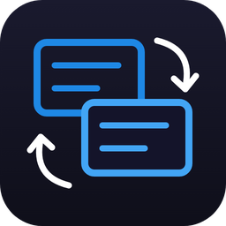

<h1 align="center">SC Profile Switcher</h1>

One Stream Deck key switches your Simucube ActivePedal and wheelbase to the right Tuner profiles. 
Free, for Simucube Tuner 3.2+ on Windows.

Changing cars or sims means opening Tuner and clicking through two profile lists. With SC Profile Switcher you set that up once per key: press **GT3**, and the pedal and the wheelbase both switch in about a quarter of a second, without bringing Tuner to the front.

## Actions

| Action | What it does |
| --- | --- |
| **Profile Set** | Loads a pedal profile and a wheelbase profile together. Leave either on "Don't change". |
| **Single Profile** | Loads one profile; the other device keeps its own. |

Keys show the profile names (you can turn that off), a check mark when the switch went through, and a warning triangle when it did not.

## Requirements

- Windows 10 or 11
- Stream Deck app 7.1 or newer (any Stream Deck with keys, or Stream Deck Mobile)
- Simucube Tuner 3.2 or newer, **running**
- Your profiles saved as local profiles in Tuner

| Device | Status |
| --- | --- |
| ActivePedal (Pro) | Tested |
| Simucube 3 | Tested |
| Simucube 2 | Should work, not tested yet. Its profiles appear under "Other devices". [Tell us how it went](../../issues/new?template=device-report.yml). |

## Install

1. Install from the **Elgato Marketplace** (search "SC Profile Switcher"), or download `com.badcodes.sc-profile-switcher.streamDeckPlugin` from [Releases](../../releases/latest) and double-click it.
2. In Stream Deck, find **SC Profile Switcher** in the action list on the right.

## Set up a key (1 minute)

1. **Save your profiles in Tuner first.** Switching discards unsaved edits, the same as picking a profile in Tuner.
2. Drag **Profile Set** onto a key.
3. In the settings below the keys, pick a **Pedal** profile and a **Wheelbase** profile. Use the refresh button next to a list after you add profiles in Tuner.
4. Press the key. Both devices switch, and the key shows a check mark.

Repeat for each car or sim. Use **Single Profile** when you only want to change one device, for example a wet-weather brake profile.

## Troubleshooting

| You see | Why, and what to do |
| --- | --- |
| Warning triangle on press | Tuner is not running, or the chosen profile was deleted or renamed in Tuner. Start Tuner, then open the key settings and pick the profile again. |
| "No local profiles found" | Save a profile in Tuner (downloaded profiles must be saved as your own), then press refresh. |
| "Could not read Tuner profiles" | Tuner's profile list could not be read. Restart Tuner and press refresh; if it persists, open an issue with the log (below). |
| Key shows "?" | The chosen profile no longer exists. Pick it again. |

**Log file** for bug reports: `%APPDATA%\Elgato\StreamDeck\Plugins\com.badcodes.sc-profile-switcher.sdPlugin\logs\com.badcodes.sc-profile-switcher.0.log`

## Support

- [Report a bug](../../issues/new?template=bug-report.yml)
- [Report how it works with your device](../../issues/new?template=device-report.yml) (Simucube 2 owners especially)
- [Request a feature](../../issues/new?template=feature-request.yml)

## License

MIT. Made by [BadCodes](https://github.com/BadCodesGG).

Not affiliated with or endorsed by Simucube or Granite Devices Oy. Simucube and Simucube Tuner are trademarks of their respective owner.
